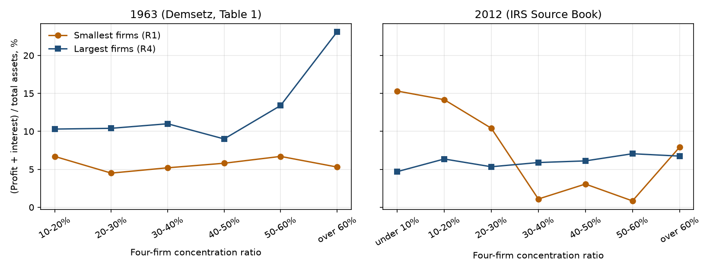
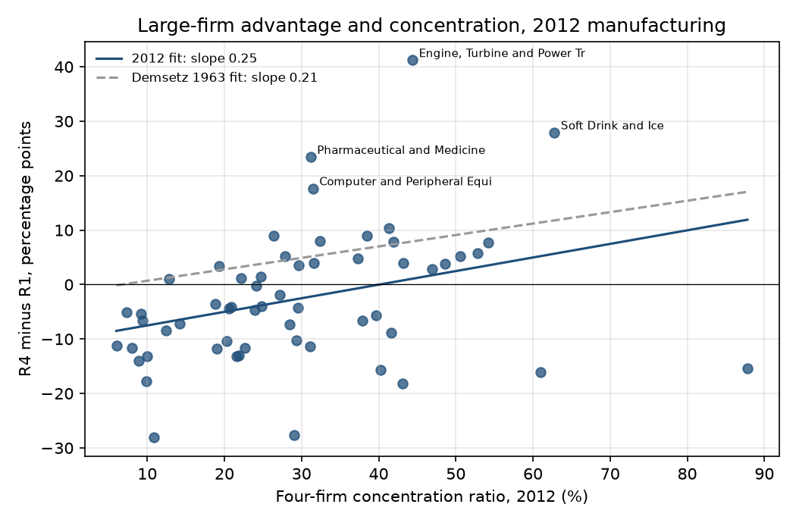
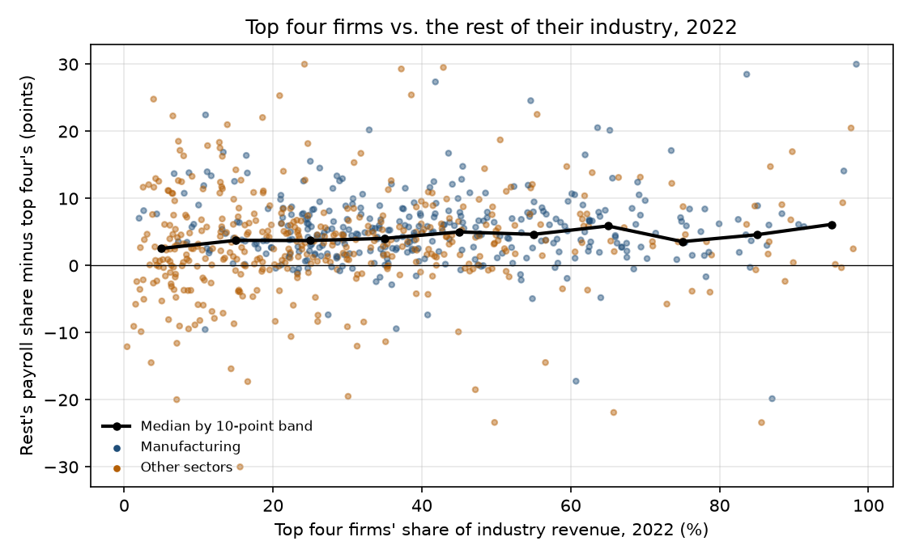

# Big Firms, Small Firms

### In 1973, Harold Demsetz asked whether the profits of concentrated industries came from collusion or from the superior efficiency of their largest firms. With the same IRS tax tables and the newest Census counts, I asked again.

---

Most of the beer sold in America in 2012 came from two companies, Anheuser-Busch InBev and MillerCoors. The Census
Bureau's count for that year puts the four largest brewing companies at 87.8% of the $28.4 billion of beer shipped
from American breweries. If any industry should have been earning outsized profits from its concentration, it was
this one. The corporate tax returns tell a different story. The IRS tabulated 302 brewing corporations with less
than $5 million in assets that year, and together they earned 20.1 cents of profit and interest on every dollar of
assets. The four brewing corporations with more than $500 million in assets earned 4.7 cents.

Beer is one case of an old argument about big business. When a few firms
dominate a market, they may be holding prices up together, or they may simply be better at the job than everyone
else, and the two explanations call for opposite policies. In 1973 an economist named Harold Demsetz showed how to
tell them apart using the tax returns of small and large firms in the same industry. The IRS kept publishing the
tables he used through tax year 2013, so I rebuilt his test on them and then carried the question forward with the
2017 and 2022 Economic Census.

---

## Two measures

The first measure is the one the Census Bureau publishes for every manufacturing industry in each Economic Census, the
share of an industry's sales made by its four largest companies. Writing $`S_{\text{top 4}}`$ for their shipments and
$`S`$ for the whole industry's,

```math
\text{CR4} = \frac{S_{\text{top 4}}}{S}, \qquad \text{CR4}_{\text{breweries, 2012}} = \frac{S_{\text{top 4}}}{\$28.4\text{ billion}} = 87.8\%
```

The second is Demsetz's rate of return, the profit a group of firms earns plus the interest it pays its lenders,
divided by everything the group owns. Adding back interest puts a firm financed by debt on the same footing as one
financed by its owners. For the size class $`k`$ of an industry, with $`\Pi_k`$ net income before tax, $`I_k`$
interest paid and $`A_k`$ total assets,

```math
R_k = \frac{\Pi_k + I_k}{A_k}
```

For the 302 small breweries and the four big ones, in thousands of dollars,

```math
R_1 = \frac{50{,}489}{251{,}422} = 20.1\%, \qquad R_4 = \frac{4{,}349{,}810}{92{,}944{,}946} = 4.7\%
```

Demsetz sorted every corporation into four size classes by assets. His dollar lines from 1963 would put a
$60 million company in the same class as the largest corporations of 2012, so I scaled them by the rise in consumer prices from 1963 to 2012, a factor
of 7.5, and rounded to the nearest boundary the IRS publishes. The scaled lines happen to be exactly ten times his.

| Size class | Demsetz, 1963 dollars | This study, 2012 dollars | Corporations in my 58 industries, 2012 |
|---|---|---|---|
| R1, smallest | under $0.5 million | under $5 million | 150,368 |
| R2 | $0.5 to $5 million | $5 to $50 million | 18,869 |
| R3 | $5 to $50 million | $50 to $500 million | 3,733 |
| R4, largest | over $50 million | over $500 million | 1,173 |

---

## Harold Demsetz's question

Harold Demsetz was born in Chicago in 1930 and earned his doctorate at Northwestern in 1959. He taught at Michigan and
UCLA, spent eight years at the University of Chicago's business school, and returned to UCLA for good in 1971. By then
he had written a celebrated paper on why property rights emerge and, with Armen Alchian, one on how firms organize
teams of workers. He died in January 2019, at 88.

His 1973 paper, "Industry Structure, Market Rivalry, and Public Policy," is nine pages long and was aimed at a
doctrine then guiding antitrust. Economists since Joe Bain had found that concentrated industries earned higher
profits and read the pattern as evidence that a few firms could collude. Demsetz pointed out that the correlation fit
a second story equally well. A firm that finds a cheaper way to make something, or a better product, grows at its
rivals' expense, so the industry becomes more concentrated at the same moment that its leader becomes more
profitable. Breaking up such an industry would punish the success that created it.

His test rests on a short argument. Suppose the firms in an industry collude on a common price $`P`$, and every firm,
large or small, produces at the same cost $`c`$ per unit with the same capital $`k`$ per unit of output. A firm
producing $`q_i`$ units then earns

```math
\begin{aligned}
\pi_i &= (P - c)\,q_i, \qquad K_i = k\,q_i \\
R_i &= \frac{\pi_i}{K_i} = \frac{(P - c)\,q_i}{k\,q_i} = \frac{P - c}{k} \quad \text{for every } i \\
R_{\text{large}} > R_{\text{small}} \;&\Longrightarrow\; \frac{P - c_{\text{large}}}{k_{\text{large}}} > \frac{P - c_{\text{small}}}{k_{\text{small}}}
\end{aligned}
```

Collusion at a shared price lifts every firm's rate of return together, so a return gap between large and small firms
in the same industry has to come from a difference in cost or quality. That gives two predictions. If concentration
breeds collusion, small firms should earn more in concentrated industries, because they sell at the same propped-up
price. If concentration reflects efficiency, the gap between large and small firms should widen as concentration rises.

Demsetz took 1963 IRS returns for 95 manufacturing industries and found the second pattern. In the three industries
where the top four held more than 60% of sales, the largest firms earned 23.1% and the smallest 5.3%. Across all 95,
he regressed the large-minus-small gap on the 1963 concentration ratio $`C_{63}`$ and reported

```math
R_4 - R_1 = -1.4 + \underset{(0.07)}{0.21}\, C_{63}, \qquad r^2 = 0.09
```

Each additional point of concentration widened the gap between the biggest and smallest firms by about a fifth of a
point, while the smallest firms earned no more in concentrated industries than elsewhere.

The paper became one of the standard arguments against reading market power off the profit rates of concentrated
industries. The strongest objection to it applies to the whole method. Steven Berry, Martin Gaynor and Fiona Scott
Morton restated it in 2019, arguing that cross-industry comparisons of this kind cannot identify market power at all,
because concentration, costs and profits are all determined together, and Demsetz's version is no exception. A large firm can be both more efficient and a beneficiary of soft
competition. Demsetz did not claim to rule that out. He claimed only that his numbers gave no support to the idea that
concentration alone lets everyone in an industry charge more, and that is the claim I tested.

---

## How I tested it

The IRS Corporation Source Book reports balance sheets and income statements for every industry by the size of its
corporations' assets, built from a stratified sample of tax returns. It is the series Demsetz used, and the IRS
stopped producing it after tax year 2013. My main run pairs tax year 2012 with the 2012 Economic Census, as Demsetz
paired 1963 with 1963. I kept his rules where the data allowed. The return is net income plus interest paid over
total assets. Industries with no corporations in one of the four size classes are dropped, as he dropped those with
no large firms. The Source Book groups manufacturing into 64 industries rather than his 95, and 58 survive the rule.
Tobacco, the three apparel industries, leather and furniture fall out because one size class is empty or withheld.
Each industry's concentration ratio is the Census figure published for the codes it covers, averaged by shipments
where the IRS industry combines several.

For industry $`j`$ and each comparison class $`k = 1, 2, 3`$, I estimate Demsetz's Table 3 and the direct collusion
test on small firms,

```math
\begin{aligned}
R_{4j} - R_{kj} &= \alpha_k + \beta_k\,\text{CR4}_j + \varepsilon_{kj}, \qquad H_0\!: \beta_k = 0 \\
R_{1j} &= \gamma + \delta\,\text{CR4}_j + u_j, \qquad \text{collusion predicts } \delta > 0
\end{aligned}
```

Demsetz reported conventional standard errors, so I show those first and heteroskedasticity-robust (HC1) errors
beside them. Because a single year of small-firm returns is noisy, I also stack tax years 2007, 2012 and 2013, add a
fixed effect for each year, and cluster the standard errors by industry. The extension uses the Economic Census's own
split of each of about 900 industries into its four largest firms and everyone else, which every sector the census
covers reports for 2017 and 2022.

---

## The largest firms no longer stand apart in concentrated industries

| Concentration (CR4) | Industries, 1963 | Largest firms, 1963 | Smallest firms, 1963 | Industries, 2012 | Largest firms, 2012 | Smallest firms, 2012 |
|---|---|---|---|---|---|---|
| under 10% | | | | 8 | 4.7% | 15.3% |
| 10–20% | 14 | 10.3% | 6.7% | 7 | 6.4% | 14.2% |
| 20–30% | 22 | 10.4% | 4.5% | 19 | 5.3% | 10.4% |
| 30–40% | 24 | 11.0% | 5.2% | 9 | 5.9% | 1.1% |
| 40–50% | 21 | 9.0% | 5.8% | 9 | 6.1% | 3.1% |
| 50–60% | 11 | 13.4% | 6.7% | 3 | 7.1% | 0.8% |
| over 60% | 3 | 23.1% | 5.3% | 3 | 6.7% | 7.9% |

*Simple averages across industries. 1963 figures are Demsetz's Table 1.*

In 1963 the largest firms out-earned the smallest in every row, and in the most concentrated industries they earned
more than four times as much. In 2012 the largest manufacturers' average return in each band ran from 4.7% to 7.1%, and
the 23% that Demsetz found at the top has no modern counterpart. The three industries above 60% in 2012
were breweries, soft drinks and aerospace, homes of Anheuser-Busch InBev, Coca-Cola, PepsiCo, Boeing and Lockheed
Martin, and their largest corporations earned 4.7%, 10.2% and 5.4%.



The smallest firms did the opposite of what they did in 1963. In unconcentrated industries such as structural metals,
wood products and plastics, corporations with under $5 million in assets earned 15.3% on average, three times the
return of the giants. Part of that is how small companies keep their books. Across all of manufacturing, officers'
pay came to 14.5% of assets for the smallest class and 0.2% for the largest, and 58% of small-firm assets sat in
S corporations, whose owners can take part of their income as profit rather than salary. At the other end, 35.7% of the
largest corporations' assets were investments in other companies and another 12.7% were acquired intangibles such as
goodwill, which swells the denominator of their return without adding a factory.

---

## The gap still widens with concentration, because small firms fall behind

The average rows hide what Demsetz's regression catches. Run his Table 3 on the 58 industries of 2012 and the result
is close to his.

```math
\begin{aligned}
2012\!: \quad R_4 - R_1 &= -10.0 + \underset{(0.097)}{0.250}\,\text{CR4}, \quad p = 0.012\ \ (\text{robust } p = 0.080), \quad N = 58 \\
2012\!: \quad R_1 &= 14.9 - \underset{(0.093)}{0.223}\,\text{CR4}, \quad p = 0.020 \\
\text{Pooled 2007, 2012, 2013}\!: \quad \hat{\beta}_1 &= \underset{(0.078)}{0.158}, \quad p = 0.043, \quad N = 176
\end{aligned}
```

The slope of 0.25 is within a standard error of Demsetz's 0.21, but it arrives by a different route. In 1963 the gap
widened because large firms earned more in concentrated industries. In 2012 it widens because small firms earn less,
by 0.22 points for every point of concentration, while the largest firms' return barely moves (0.027 per point,
p = 0.18). The intercept tells the rest. At zero concentration the smallest firms would out-earn the largest by ten
points, and the two meet at a concentration ratio of about 40%.



The single-year result is fragile. With robust standard errors its p-value is 0.08, and in tax years 2013 and 2007 the
same slope is 0.13 and 0.09 and not significant. The IRS also deletes some small cells to protect individual
companies' returns, and in seven of the 58 industries such a cell sits inside the smallest or largest class. Dropping
those seven raises the 2012 slope to 0.28, still with a robust p-value of 0.08. What holds in every year is the direction. Across the three years,
all nine large-minus-smaller slopes are positive, and the smallest firms' return falls with concentration each time.
Stacked together, the gap between the largest and smallest classes widens by 0.16 points per point of concentration,
the gap between the largest and the $5 to $50 million class by 0.09 (p = 0.014), and the largest firms' own return
rises by 0.045 points per point (p = 0.011).

| Industry | Who leads it | CR4, 2012 | Smallest firms | Largest firms |
|---|---|---|---|---|
| Breweries | Anheuser-Busch InBev, MillerCoors | 88% | 20.1% | 4.7% |
| Soft drinks | Coca-Cola, PepsiCo, Dr Pepper Snapple | 63% | −17.8% | 10.2% |
| Aerospace | Boeing, Lockheed Martin | 61% | 21.4% | 5.4% |
| Petroleum refining | ExxonMobil, Chevron, Marathon, Valero | 47% | 4.1% | 7.0% |
| Pharmaceuticals | Pfizer, Merck, Johnson & Johnson | 31% | −17.8% | 5.6% |
| Architectural and structural metals | Thousands of fabricators | 6% | 14.0% | 2.9% |

Collusion predicts that the small firms in the top half of this table should do well, protected by the prices the
leaders set. Some did, like the small breweries and aerospace suppliers. Small soft-drink bottlers and small drug
companies lost money in aggregate, which for the drug makers I suspect reflects research-stage companies with no
product on the market. On average, small firms earned less the more concentrated their industry, which is the opposite of
what a collusion story needs.

Demsetz also asked whether industries where concentration was rising showed wider gaps, and found a positive but
insignificant effect of the 1963 to 1967 change. Adding the change in concentration from 2007 to 2012 gives negative
coefficients in 2012, none significant at 5% with his conventional errors. In the 2013 run the coefficient for the
largest-minus-smallest gap is −0.54 (p = 0.037), significant and of the opposite sign to his, so that part of his
argument finds no support here.

---

## Industry leaders in 2022 spend less on payroll per dollar of sales almost everywhere

Without the IRS tables, the closest present-day look at leaders against their rivals is the Economic Census, which
for 2017 and 2022 reports revenue, payroll and employment for each industry's four largest firms and for all firms.
It does not report profit, so I used the measure behind the "superstar firm" account of David Autor and coauthors,
which descends from Demsetz. For the top four or the rest of an industry, with payroll $`W`$ and revenue $`Y`$,

```math
s = \frac{W}{Y}, \qquad \text{gap} = s_{\text{rest}} - s_{\text{top 4}}
```

The four largest wireless carriers, Verizon, AT&T and T-Mobile among them, took in $273.2 billion in 2022 and had a
payroll of $19.7 billion. The rest of the industry took in $9.8 billion and paid $1.6 billion. In millions of dollars,

```math
s_{\text{top 4}} = \frac{19{,}717}{273{,}198} = 7.2\%, \qquad s_{\text{rest}} = \frac{1{,}620}{9{,}773} = 16.6\%, \qquad \text{gap} = 9.4 \text{ points}
```

In 2022, in 82% of the 770 industries with complete figures, the top four spent a smaller share of revenue on payroll
than the rest of their industry. Their revenue per worker was typically 1.53 times their rivals', and they paid each
worker about 16% more, so their pay premium is much smaller than their productivity premium.

| Concentration (CR4), 2022 | Industries | Top four's payroll share | Rest's payroll share | Top four's share is lower | Revenue per worker, top four ÷ rest |
|---|---|---|---|---|---|
| under 20% | 219 | 22.2% | 27.0% | 73% of industries | 1.42 |
| 20–40% | 274 | 13.2% | 19.0% | 85% | 1.53 |
| 40–60% | 162 | 10.9% | 16.8% | 86% | 1.69 |
| 60% and over | 115 | 11.1% | 17.3% | 87% | 1.69 |

*Medians across industries. Finance and insurance are excluded because their revenue includes premiums and interest.*

The leaders' edge is a little larger in concentrated industries, but it is present at every level, and once
industries are compared within the same sector the payroll gap does not rise with concentration in a statistically
meaningful way (0.014 points per point of CR4, p = 0.38). The productivity ratio does rise, by about 0.2% per point.



| Industry, 2022 | Leading firms | CR4 | Top four's payroll share | Rest's |
|---|---|---|---|---|
| Wireless carriers | Verizon, AT&T, T-Mobile | 97% | 7.2% | 16.6% |
| Home centers | Home Depot, Lowe's | 98% | 8.4% | 10.9% |
| Pharmacies | CVS, Walgreens | 71% | 5.1% | 8.0% |
| Drug wholesalers | McKesson, AmerisourceBergen, Cardinal Health | 50% | 0.6% | 6.2% |
| Warehouse clubs and supercenters | Walmart, Costco | 96% | 7.8% | 8.0% |
| Scheduled airlines | Delta, American, United, Southwest | 73% | 19.6% | 13.9% |

Airlines run the other way. The four big carriers spend a larger share of revenue on payroll than the rest of the
scheduled airlines, and they also pay each worker about a quarter more.

The change from 2017 to 2022 looked at first like a strong confirmation. In the 696 industries with the same code in
both years, each point of added concentration went with a 0.22-point wider payroll gap (p < 0.001). The result does
not survive a simple check. Revenue appears in both the concentration ratio and the payroll share, so a year in which
the leaders' sales jump raises one and lowers the other by arithmetic alone. Measuring concentration by the leaders'
share of employment instead reverses the sign, to −0.25. Five years of census data cannot separate a real widening
of the leaders' advantage from that arithmetic, and I don't count it as evidence either way.

---

## Why it matters

For consumers, the largest companies in the most concentrated manufacturing industries of 2012 earned about what large
companies earned everywhere else. The biggest brewers and aerospace makers made under 6% on the assets their tax
returns report, and nothing in the tax tables suggests that a high concentration ratio by itself marks an industry
whose leaders are collecting unusual profits from shoppers.

For workers, the leaders in most industries produce more per employee and pay more per employee, while spending a
smaller share of each sales dollar on wages. That is the pattern Autor and his coauthors describe, in which the
economy's labor share falls as sales shift toward leading firms while pay per worker at those firms is higher, not
lower.

For smaller firms, the pattern is the most consistent result here. The more concentrated their industry, the less
the smallest corporations earned, in each of the three years I measured, although the slope is statistically
significant only in 2012. That is the opposite of what they would expect if the leaders were holding up prices for
everyone, and consistent with small firms selling against leaders whose costs are lower.

For policy, Demsetz's warning holds up better than his headline number. An industry-wide concentration ratio is a
weak guide to whether buyers are overcharged, and a rule that treated every concentrated industry as suspect would
have flagged breweries and aerospace in 2012, where the largest firms earned less than the smallest. The data here
lean toward his view that concentrated industries are not cartels by default, and they cannot rule out that
particular leaders also enjoy pricing power in particular markets.

---

## Limits of this study

The IRS tables stop in 2013, so the profit test describes the manufacturing economy of more than a decade ago, and the newer
census evidence measures payroll and productivity rather than profit. Tax-return balance sheets are consolidated, so
the largest corporations' assets include foreign subsidiaries, financial arms and acquisition goodwill, and their
profits include earnings from outside the industry they are filed under. Small corporations' profits depend on how
owners split their income between salary and profit, which differs between ordinary and S corporations. The Source
Book's 64 industries are broad, so a single concentration ratio stands for markets as different as breakfast cereal
and pet food. Imports are not counted. A few cells are estimated from small samples or withheld. And like Demsetz's,
these are correlations across industries within single years, which cannot show that concentration caused anything.

---

## Further reading

- [TECHNICAL.md](TECHNICAL.md) has the data, rules, every test statistic and how to reproduce the results.
- [results/FINDINGS.md](results/FINDINGS.md) has a plain-English summary and every table the scripts produce.
- [METHODS_REVIEW.md](METHODS_REVIEW.md) is a methods and statistical-reporting review of the original paper.
- The original paper is Harold Demsetz, "Industry Structure, Market Rivalry, and Public Policy," *Journal of Law and
  Economics* 16(1), April 1973, pp. 1–9.
- Steven Berry, Martin Gaynor and Fiona Scott Morton, "Do Increasing Markups Matter? Lessons from Empirical
  Industrial Organization," *Journal of Economic Perspectives* 33(3), 2019, pp. 44–68.
- David Autor, David Dorn, Lawrence F. Katz, Christina Patterson and John Van Reenen, "The Fall of the Labor Share and
  the Rise of Superstar Firms," *Quarterly Journal of Economics* 135(2), 2020, pp. 645–709.
- IRS Statistics of Income, Corporation Source Book data files, tax years 2007, 2012 and 2013
  (irs.gov/statistics/soi-tax-stats-corporation-source-book-data-file).
- US Census Bureau, Economic Census concentration tables for manufacturing (2007, 2012) and all sectors (2017, 2022),
  www2.census.gov/programs-surveys/economic-census/data/.
- Bureau of Labor Statistics consumer price index (CPI-U, not seasonally adjusted), via FRED series CPIAUCNS.

*Brendyn Beasley*
